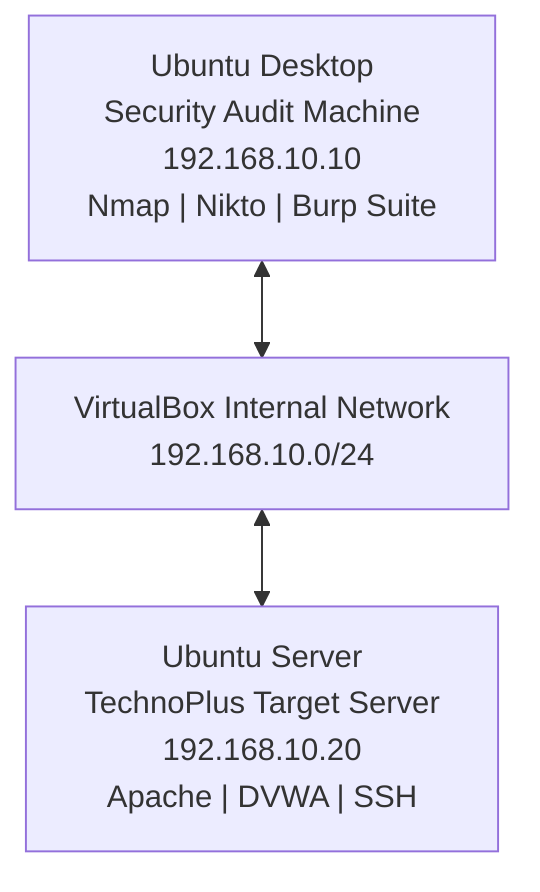

# Network Architecture – TechnoPlus

## 1. Network Topology

## 2. Infrastructure Components

| Machine | Role | IP Address |
|---|---|---|
| Ubuntu Desktop | Audit workstation | 192.168.10.10 |
| Ubuntu Server | Target server | 192.168.10.20 |

## 3. Network Configuration

- Virtualization: Oracle VirtualBox
- Network Type: Internal Network
- Network Address: 192.168.10.0/24
- Subnet Mask: 255.255.255.0

## 4. Description

Ubuntu Desktop is used to perform security assessments against Ubuntu Server.

Both virtual machines communicate through an isolated VirtualBox internal network.

## 5. Project Status

Planned architecture. IP addresses and services will be verified during implementation.
